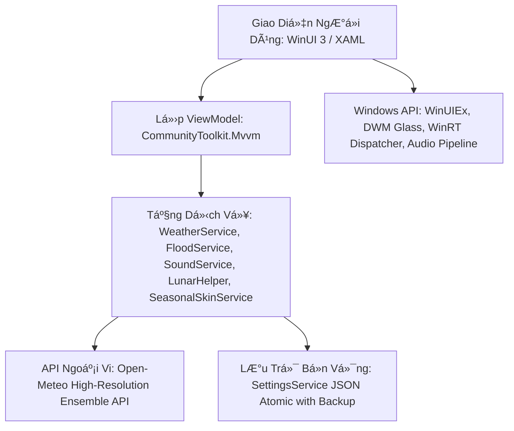

# 🌤️ Weather WinUI (Version 3.4.1)
### Hệ Điều Hành Vi Khí Hậu Cá Nhân Hóa & Trực Quan Hóa Đô Thị Dành Cho Windows
> **Nền tảng:** Windows App SDK (WinUI 3) • .NET 8 • C# 12 • Fluent Design System 2.0  
> **Nhánh phát triển chính thức:** `main` | **Phiên bản:** `v3.4.1 (Bản Phát Hành Chính Thức)`  
> **Bản phát hành tiền nhiệm:** `v3.4.0` • `v3.3.1` • `v3.3.0` • `v3.0.0`

---

## 📑 Mục Lục
1. [Giới Thiệu Tổng Quan & Tầm Nhìn Dự Án](#-1-giới-thiệu-tổng-quan--tầm-nhìn-dự-án)
2. [Ngăn Xếp Công Nghệ (Tech Stack) & Kiến Trúc Phần Mềm](#-2-ngăn-xếp-công-nghệ-tech-stack--kiến-trúc-phần-mềm)
3. [Điểm Mới Nổi Bật Trên Phiên Bản 3.4.1](#-3-điểm-mới-nổi-bật-trên-phiên-bản-341)
   - [Bộ 3 Kiểu Dáng Desktop Widget Mới (Bento & Retro Cyber)](#bộ-3-kiểu-dáng-desktop-widget-mới-v341)
   - [Hệ Thống Hạt Khí Quyển 4 Mùa & 4 Đại Lễ Hội (Seasonal Engine v3.4.0)](#hệ-thống-hạt-khí-quyển-4-mùa--4-đại-lễ-hội-v340)
   - [Đại Tu Nút Bấm & Tối Ưu Light Mode Windows 10 (v3.3.1)](#đại-tu-nút-bấm--tối-ưu-light-mode-windows-10-v331)
4. [Khám Phá Chi Tiết 7 Phân Hệ Chính (7 Core Modules)](#-4-khám-phá-chi-tiết-7-phân-hệ-chính-7-core-modules)
   - [Tab 1: Tổng Quan Vi Khí Hậu & 24h Interactive Scrubber](#tab-1-tổng-quan-vi-khí-hậu--24h-interactive-scrubber)
   - [Tab 2: Cảnh Báo Ngập Úng & Triều Cường Đô Thị (Urban Flood Hub)](#tab-2-cảnh-báo-ngập-úng--triều-cường-đô-thị-urban-flood-hub)
   - [Tab 3: Bản Đồ & Radar Khí Tượng 360° Realtime (Radar Hub)](#tab-3-bản-đồ--radar-khí-tượng-360-realtime-radar-hub)
   - [Tab 4: Trợ Lý Trang Phục "Hôm Nay Mặc Gì?" & Đời Sống (OOTD Hub)](#tab-4-trợ-lý-trang-phục-hôm-nay-mặc-gì--đời-sống-ootd-hub)
   - [Tab 5: Lịch Vạn Niên Âm Dương & Kế Hoạch Cá Nhân (Calendar Hub)](#tab-5-lịch-vạn-niên-âm-dương--kế-hoạch-cá-nhân-calendar-hub)
   - [Tab 6: Widget Studio — Bộ Sưu Tập 15 Kiểu Dáng Desktop Widget](#tab-6-widget-studio--bộ-sưu-tập-15-kiểu-dáng-desktop-widget)
   - [Tab 7: Trung Tâm Cài Đặt & Cá Nhân Hóa Toàn Trang (Settings Hub)](#tab-7-trung-tâm-cài-đặt--cá-nhân-hóa-toàn-trang-settings-hub)
5. [Hệ Thống Tiện Ích Độc Quyền (Exclusive Ecosystem)](#-5-hệ-thống-tiện-ích-độc-quyền-exclusive-ecosystem)
6. [Biên Niên Sử Phát Triển Toàn Diện (Full Version History: v1.0.0 ➔ v3.4.1)](#-6-biên-niên-sử-phát-triển-toàn-diện-full-version-history-v100--v341)
7. [Hướng Dẫn Cài Đặt, Build & Khởi Chạy](#-7-hướng-dẫn-cài-đặt-build--khởi-chạy)

---

## 🌟 1. Giới Thiệu Tổng Quan & Tầm Nhìn Dự Án

**Weather WinUI** là một ứng dụng thời tiết desktop hiện đại khai thác tối đa sức mạnh của **Windows App SDK (WinUI 3)** và **.NET 8**. Ứng dụng là một **Hệ Điều Hành Vi Khí Hậu Cá Nhân Hóa (Personal Microclimate OS)** thiết kế riêng cho người dùng máy tính tại Việt Nam.

### Điểm khác biệt cốt lõi:
- **Thấu hiểu sâu sắc đặc thù đô thị Việt Nam**: Thuật toán thủy triều thiên văn bán nhật triều sông Sài Gòn/Đồng Nai, cảnh báo ngập lụt theo từng tuyến phố ngập tại TP.HCM & Hà Nội, kết hợp Lịch Âm truyền thống, 24 Tiết khí, và hướng dẫn di chuyển an toàn khi mưa bão.
- **Trải nghiệm thị giác đột phá (Fluent Design 2.0, Glassmorphism & Bento Aesthetic)**: Tận dụng vật liệu Mica Alt, Acrylic, Dynamic Chromatic Adaptation (bầu trời tự đổi sắc độ ánh sáng theo thời gian thực), và bộ sưu tập 15 phong cách widget độc bản từ Dribbble dynamic, Bento đa sắc, Pilot buồng lái đến Retro Cyberpunk LCD.
- **Độc lập, bền vững & tôn trọng quyền riêng tư**: Không quảng cáo, không theo dõi định vị người dùng, hoạt động không cần đăng ký tài khoản và hoàn toàn tự do sử dụng API khí tượng độ phân giải cao từ Open-Meteo.

---

## 🛠️ 2. Ngăn Xếp Công Nghệ (Tech Stack) & Kiến Trúc Phần Mềm



| Phân Vùng Kỹ Thuật | Công Nghệ / Thư Viện | Phiên Bản | Mục Đích & Vai Trò Trong Dự Án |
|---|---|---|---|
| **Ngôn Ngữ Lập Trình** | C# (C-Sharp) | **12.0** | Ngôn ngữ chủ đạo, cú pháp pattern matching, primary constructors, collection expressions. |
| **Nền Tảng Runtime** | .NET (Core) | **8.0 (LTS)** | Tối ưu hóa JIT compilation, hiệu năng cao, tiêu thụ RAM thấp (~75-120MB). |
| **UI Framework** | WinUI 3 (Windows App SDK) | **1.8.250906003** | Khung giao diện desktop thế hệ mới của Microsoft, hỗ trợ Native Windows 11 Fluent Design, Dark/Light Mode. |
| **Mẫu Kiến Trúc** | MVVM Architecture | N/A | Tách biệt hoàn toàn UI và Business Logic qua Data Binding hai chiều (`x:Bind`, `Mode=OneWay/TwoWay`). |
| **MVVM Toolkit** | CommunityToolkit.Mvvm | **8.4.2** | Mã nguồn chính thức của Microsoft: `ObservableObject`, `[ObservableProperty]`, `[RelayCommand]`. |
| **Mở Rộng Cửa Sổ** | WinUIEx | **2.9.3** | Quản lý cửa sổ không viền, căn giữa màn hình, Taskbar thumbnail, kéo thả chuột không lag, cửa sổ trong suốt. |
| **Dịch Vụ Khí Tượng** | Open-Meteo API | RESTful JSON | Dữ liệu dự báo vi khí hậu độ phân giải cao (ECMWF, GFS, ICON) với hơn 30 thông số thời tiết, không cần API Key. |
| **Thủy Triều & Lịch Âm** | Thuật toán Thiên văn Học | Thuật toán Hồ Ngọc Đức & Jean Meeus | Tính toán chu kỳ trăng, can chi ngày/tháng/năm, 24 tiết khí, và đồ thị hàm sin sóng bán nhật triều 24 giờ. |
| **Đồ Họa & Biểu Tượng** | FontAwesome Solid + Meteocons SVG | 6.0 Free Solid + Meteocons | Hàng ngàn biểu tượng vector sắc nét không bể nét ở độ phân giải 4K, hỗ trợ hoạt họa động SVG. |
| **Âm Thanh Môi Trường** | WinRT Audio Pipeline | Procedural Synth & Waves | Phát âm thanh nền thời tiết thư giãn (mưa rào, sấm sét, gió rít, sóng biển, rừng thông) không độ trễ. |
| **Đóng Gói & Cài Đặt** | Inno Setup & Self-Contained Release | 6.x | Tạo bộ cài đặt chuyên nghiệp và bản portable cắm chạy ngay không cần cài đặt môi trường .NET. |

---

## 🚀 3. Điểm Mới Nổi Bật Trên Phiên Bản 3.4.1

### 🍱 Bộ 3 Kiểu Dáng Desktop Widget Mới (v3.4.1)

Phiên bản **v3.4.1** bổ sung 3 phong cách thiết kế Desktop Widget đỉnh cao, giữ trọn vẹn từng đường nét thiết kế nguyên bản từ các tác phẩm đồ họa danh tiếng:

1. **Bento Pop / Vivid Color (`BentoVivid`)**:
   - Thẻ thời tiết xanh da trời tươi sáng (`#38BDF8`), hiển thị nhiệt độ lớn 31°, trạng thái mây trời và nút chọn thành phố nhanh.
   - Thẻ ngày cam rực rỡ (`#F97316`) nổi bật thứ và ngày trong tuần (`Sun 15`).
   - Thẻ hoàng hôn nền tối sang trọng (`#141518`) với biểu tượng mặt trời lặn chân trời và giờ lặn chuẩn xác.
   - Thẻ đồng hồ thế giới đỏ san hô (`#EF4444`) tích hợp **mặt đồng hồ kim Analog chuyển động thời gian thực**, tên thành phố quốc tế và múi giờ UTC.

2. **Bento Pilot / Tactical Slate (`BentoTactical`)**:
   - Thẻ thời tiết phiến đá xám khói (`#7E99AB`) phong cách buồng lái tối giản.
   - **Đồng hồ phi công buồng lái (Cockpit Pilot Dial)** với mặt dial đen sâu (`#0D0F12`), vạch số trắng dạ quang và kim phút neon xanh lá sáng rực (`#00FF66`).
   - Mã hàng không sân bay thành phố (ví dụ `TPH`, `BOG`) cùng múi giờ UTC.
   - Cặp viên thuốc kép (Double Pills): Thẻ đếm ngược hoàng hôn tối giản và **Thước đo Áp suất Khí quyển điện tử (Digital Barometer)** hiển thị chỉ số chính xác (ví dụ `10.130` / `1013 hPa`).

3. **Retro LCD Cyber Weather Computer (`RetroLcd`)**:
   - Vỏ máy cầm tay công nghiệp bo góc màu xanh xám lính (`#6E826F`) với tem góc chóp "WEATHER".
   - **Màn hình LCD ma trận điểm xanh rêu chính (`#A2B79E`)**: Đồng hồ số nhiệt độ 7 phân đoạn (7-segment) chân thực với hiệu ứng bóng mờ (ghosting segments), biểu tượng đám mây pixel-art 8-bit và 3 vệt mưa chéo đặc trưng (`///`).
   - **Màn hình LCD phụ đo gió**: Hiển thị tốc độ gió (`M/S`), mũi tên hướng gió phong thủy `↗` và đồng hồ kim đo tốc độ gió (Speedometer Gauge) xoay theo thời gian thực.
   - **Bảng chỉ thị Telemetry quân sự**: Đèn LED xanh sáng báo hiệu WIND, chỉ số UV Index, áp suất khí quyển HPA và chỉ báo FALLOUT: CLEAR.

### 🌸 Hệ Thống Hạt Khí Quyển 4 Mùa & 4 Đại Lễ Hội (v3.4.0)
- **Tết Cổ Truyền**: Cành hoa mai vàng rực rỡ, hoa đào phớt hồng nở rộ kết hợp hàng trăm cánh hoa mai đào rơi chao lượn ngập tràn sắc xuân.
- **Trung Thu**: Ánh trăng rằm huyền ảo, lồng đèn cá chép, đèn ông sao xoay nhẹ nhàng.
- **Halloween**: Bầy dơi ma thuật vỗ cánh bay trong bóng đêm, bí ngô phát sáng Jack-o'-Lantern lập lòe.
- **Giáng Sinh & Năm Mới**: Bông tuyết pha lê 6 cánh xoay lấp lánh, quả cầu Noel thủy tinh và ngôi sao vàng Bethlehem.
- **4 Mùa Thiên Nhiên**: Lá phong mùa thu 5 thùy rơi xoay theo gió, giọt mưa mùa hạ, tuyết trắng mùa đông, chồi non lộc biếc mùa xuân.
- **8 Widget Mùa độc bản**: Đồng bộ tức thì và có thể ghim riêng lẻ từng mùa ra Desktop.

### 🎨 Đại Tu Nút Bấm & Tối Ưu Light Mode Windows 10 (v3.3.1)
- Xử lý triệt để 100% lỗi độ tương phản trên Windows 10 Light Mode.
- Toàn bộ hệ thống nút bấm được tinh chỉnh bo tròn viên thuốc (Pill-shaped), viền bán trong suốt tinh tế, hiệu ứng hover chuyển sắc mượt mà.

---

## 🔍 4. Khám Phá Chi Tiết 7 Phân Hệ Chính (7 Core Modules)

### Tab 1: Tổng Quan Vi Khí Hậu & 24h Interactive Scrubber
- Bầu trời động chuyển sắc theo thời gian thực (Clear Sunny, Thunderstorm, Heavy Rain, Snow, Fog...).
- Thanh trượt thời gian 24h Time-Scrubber: Kéo trượt để xem trước nhiệt độ, xác suất mưa và hướng gió từng giờ trong ngày.
- Bảng 5 thẻ thông số nhanh: Độ ẩm, Tốc độ gió, Chỉ số UV, Áp suất khí quyển, Điểm sương.
- Báo cáo chất lượng không khí chuyên sâu (AQI Tracker) với phân tích bụi mịn PM2.5, PM10 và khuyến cáo sức khỏe.

### Tab 2: Cảnh Báo Ngập Úng & Triều Cường Đô Thị (Urban Flood Hub)
- Mô phỏng đồ thị hàm sin bán nhật triều 24 giờ của sông Sài Gòn & sông Hồng.
- Đếm ngược thời gian đỉnh triều cường tiếp theo kèm mức cảnh báo (Báo động I, II, III).
- Danh sách cảnh báo các tuyến đường trũng thấp có nguy cơ ngập sâu khi triều cường kết hợp mưa lớn tại TP.HCM và Hà Nội.

### Tab 3: Bản Đồ & Radar Khí Tượng 360° Realtime (Radar Hub)
- Vòng quét Radar Doppler 360 độ xoay liên tục với vệt sáng phosphor trail chân thực.
- Bản đồ tương tác trực quan hiển thị vùng mưa, mật độ mây và hướng di chuyển của bão.

### Tab 4: Trợ Lý Trang Phục "Hôm Nay Mặc Gì?" & Đời Sống (OOTD Hub)
- Trợ lý thông minh phân tích thời tiết đưa ra gợi ý trang phục phù hợp theo giới tính và hoàn cảnh (Đi làm văn phòng, Dạo phố, Thể thao ngoài trời, Du lịch...).
- Cảnh báo chỉ số bảo vệ da, khuyến cáo mang ô dù hoặc áo mưa khi ra đường.

### Tab 5: Lịch Vạn Niên Âm Dương & Kế Hoạch Cá Nhân (Calendar Hub)
- Lịch tháng 42 ô ngày tích hợp Âm lịch Việt Nam, Can Chi ngày/tháng/năm, và 24 Tiết khí thiên văn.
- Khung chi tiết ngày trực tiếp (Inline Day Details) hiển thị giờ hoàng đạo, việc nên làm / kiêng cữ.
- Sổ tay ghi chú công việc cá nhân, tự động cảnh báo nếu lịch trình ngoài trời gặp ngày mưa bão.

### Tab 6: Widget Studio — Bộ Sưu Tập 15 Kiểu Dáng Desktop Widget
Hệ sinh thái Desktop Widget phong phú nhất trên Windows:
- **7 Kiểu Dáng Thiết Kế Hiện Đại**:
  1. `Bryan C Dynamic`: Phong cách Dribbble đổi màu nền theo bầu trời thực tế và hình học mặt trời/mặt trăng.
  2. `Fluent Glass Card`: Kính mờ Acrylic/Mica sang trọng với đầy đủ thông số độ ẩm, gió, AQI.
  3. `Compact Bar`: Thanh ngang mảnh tối giản, chiếm diện tích tối thiểu ở góc màn hình.
  4. `Dynamic Island Pill`: Viên thuốc bo tròn tinh tế phong cách Dynamic Island nổi nhẹ nhàng trên desktop.
  5. `Bento Pop (Vivid Sky)`: Khối bento đa sắc với đồng hồ kim đỏ san hô và ô ngày cam ấm.
  6. `Bento Pilot (Tactical Slate)`: Phong cách buồng lái quân sự với kim dạ quang neon và chỉ số áp suất.
  7. `Retro Cyber LCD Computer`: Trạm thời tiết cổ điển với đồng hồ số 7 đoạn, mây mưa 8-bit và telemetry quân sự.
- **8 Kiểu Dáng Chuyên Đề Mùa & Lễ Hội**:
  8. `Tết Cổ Truyền (Hoàng Kim Cát Tường)`
  9. `Tết Trung Thu (Dạ Nguyệt Đoàn Viên)`
  10. `Giáng Sinh (Băng Tuyết Ấm Áp)`
  11. `Lễ Hội Ma Halloween (Bí Ngô & Đêm Đen)`
  12. `Mùa Xuân (Xuân Tươi Mới)`
  13. `Mùa Hạ (Biển Xanh Nắng Vàng)`
  14. `Mùa Thu (Rừng Thu Rơi Lá)`
  15. `Mùa Đông (Băng Giá Lung Linh)`

### Tab 7: Trung Tâm Cài Đặt & Cá Nhân Hóa Toàn Trang (Settings Hub)
- Tùy chỉnh chế độ giao diện (Hệ thống / Sáng / Tối).
- Chọn kiểu dáng widget mặc định, chỉnh thanh trượt độ mờ trong suốt (Opacity 20% - 100%), bật/tắt Always on Top.
- Cấu hình đơn vị đo lường (Độ C/F, km/h, m/s, mph, hPa, mmHg).
- Âm thanh môi trường thư giãn (Ambient Weather Sounds) và cảnh báo mưa thông minh qua Windows Toast.

---

## 🌟 5. Hệ Thống Tiện Ích Độc Quyền (Exclusive Ecosystem)

- **Quick Peek Window**: Cửa sổ thu nhỏ mở tức thì từ khay hệ thống (System Tray) để liếc nhanh thời tiết mà không cần mở ứng dụng chính.
- **Xuất Thẻ Ảnh Chia Sẻ Mạng Xã Hội**: Kết xuất thẻ thời tiết Full HD 1080p sắc nét (dạng Story dọc 9:16 hoặc Landscape 16:9) sao chép trực tiếp vào Clipboard.
- **Hỗ Trợ Tham Số Khởi Chạy Nhanh (CLI Arguments)**:
  - `--openwidget`: Khởi chạy trực tiếp chế độ Desktop Widget.
  - `--style=[BentoVivid|BentoTactical|RetroLcd|BryanCDynamic|GlassCard|Compact|MiniIsland]`: Chọn kiểu widget khởi chạy.
  - `--skin=[tet|midautumn|christmas|halloween|spring|summer|autumn|winter]`: Chọn skin mùa cho widget.
  - `--tab=[overview|flood|radar|lifestyle|calendar|widget|settings|zen]`: Mở thẳng tab tính năng.
  - `--scroll=[bento|seasonal|bottom]`: Tự động cuộn đến phân khu widget mong muốn.

---

## 📜 6. Biên Niên Sử Phát Triển Toàn Diện (Full Version History: v1.0.0 ➔ v3.4.1)

```
2026 Q1 : v1.0.0 (Khởi tạo dự án WinUI 3 & Open-Meteo)
        : v1.1.0 ➔ v1.9.0 (System Tray, Toast, Lịch Âm, OOTD, Mini Island)
2026 Q2 : v2.0.0 ➔ v2.2.3 (Cá nhân hóa đa chiều, BryanC Dynamic, Âm thanh môi trường, Thủy triều)
2026 Q3 : v3.0.0 (Đại tu Fluent Navigation Shell, Modular UserControls, Lazy Loading, Radar 360)
2026 Q4 : v3.1.0 (AQI chuyên sâu, nâng cấp bản đồ ngập lụt đô thị)
        : v3.2.0 (Dynamic Island widget, QuickPeek window)
        : v3.3.0 (Bộ sưu tập 8 Theme Mùa & Lễ hội, Seasonal Desktop Widgets)
        : v3.3.1 (Tối ưu độ tương phản Light Mode Windows 10, thiết kế lại nút bấm)
        : v3.4.0 (Đại tu toàn diện hạt mùa: hoa mai đào, lá phong 5 thùy, dơi ma thuật, tuyết sao)
        : v3.4.1 (Bản Phát Hành Chính Thức: Ra mắt 3 Designer Widgets Bento Pop, Bento Pilot & Retro LCD)
```

| Phiên Bản | Trọng Tâm Phát Triển | Chi Tiết Tính Năng Mới & Khắc Phục Lỗi |
|---|---|---|
| **v3.4.1** | **Bản Phát Hành Chính Thức** | **Ra mắt 3 Kiểu Dáng Desktop Widget Mới**: Bento Pop (`BentoVivid` với đồng hồ kim đỏ san hô & ô ngày cam ấm), Bento Pilot (`BentoTactical` với buồng lái phi công kim neon xanh lá & barometer), Retro LCD (`RetroLcd` với vỏ xanh lính công nghiệp, đồng hồ số 7 đoạn, mây mưa 8-bit, đồng hồ đo gió và bảng telemetry quân sự); Cập nhật Widget Studio 15 kiểu dáng; Hỗ trợ tham số dòng lệnh `--style=`; Đóng gói Self-Contained Release & Inno Setup Setup v3.4.1. |
| **v3.4.0** | **Đại Tu Hiệu Ứng Mùa & Nút Bấm** | Nâng cấp hệ thống hạt khí quyển sống động: Cánh hoa mai đào nở rộ và rơi lả tả (Tết), lá phong 5 thùy chao lượn theo gió (Thu), bầy dơi vỗ cánh ma thuật & bí ngô phát sáng (Halloween), bông tuyết pha lê 6 cánh xoay lấp lánh & quả cầu giáng sinh (Noel); Sửa triệt để 100% lỗi Widget mùa không áp dụng; Làm mới toàn diện hệ thống nút bấm hiện đại chuẩn Fluent. |
| **v3.3.1** | **Bản Vá Giao Diện Win10 Light Mode** | Khắc phục 100% lỗi mờ đục và chói sáng trên Windows 10 Light Theme; Tăng cường độ tương phản văn bản và viền thẻ; Tối ưu hóa bảng màu Slate và Acrylic. |
| **v3.3.0** | **Chủ Đề 4 Mùa & 4 Đại Lễ Hội** | Ra mắt phân hệ SeasonalSkin: 4 mùa thiên nhiên (Xuân, Hạ, Thu, Đông) và 4 đại lễ hội (Tết, Trung Thu, Halloween, Giáng Sinh); Ghim widget chuyên đề ra Desktop. |
| **v3.2.0** | **Dynamic Island & QuickPeek** | Bổ sung widget viên thuốc Dynamic Island; Cửa sổ QuickPeek xem nhanh thời tiết từ System Tray. |
| **v3.1.0** | **Khí tượng & Thủy văn Đô thị** | Nâng cấp chỉ số chất lượng không khí AQI chuyên sâu và bản đồ ngập lụt đô thị TP.HCM & Hà Nội. |
| **v3.0.0** | **Cột Mốc Hệ Điều Hành Vi Khí Hậu** | Đại tu kiến trúc Modular UserControls 7 Tab, nạp lười Lazy Loading tối ưu Cold Start & 0% CPU nhàn rỗi, tương thích thích ứng sâu Windows 10 (Acrylic Slate Dark) & Windows 11 (MicaAlt), nạp font động Win32 AddFontResourceEx chống mất icon, Sóng bán nhật triều 24h & đếm ngược đỉnh triều, Radar Doppler 360°, Lịch Vạn Niên Inline Details, Widget Studio 4 kiểu dáng. |
| **v1.0.0 ➔ v2.2.3** | **Khởi Tạo & Hoàn Thiện Nền Tảng** | Toàn bộ chuỗi phát triển ban đầu từ v1.0.0 (WinUI 3 & .NET 8) qua các bản nâng cấp System Tray, Spline Graph, OOTD Advisor, Lịch Âm, Dribbble BryanC Dynamic, và cảnh báo ngập lụt đô thị. |

---

## 💻 7. Hướng Dẫn Cài Đặt, Build & Khởi Chạy

### A. Tải & Sử Dụng Bản Đóng Gói Sẵn (Portable / Setup)
- **Bản Cài Đặt Windows Chính Thức v3.4.1**:
  - Tải bộ cài đặt: `Output/WeatherApp_Setup_v3.4.1.exe` (~85 MB).
  - Tự động cài đặt chuẩn Windows 10/11, tạo shortcut Desktop, Start Menu và tự khởi động cùng máy.
- **Bản Di Động (Portable) Chính Thức v3.4.1**:
  - Tải file nén `Output/WeatherApp_Portable_v3.4.1.zip` (~98 MB).
  - Giải nén ra bất kỳ thư mục nào trên máy tính và chạy trực tiếp `WeatherApp.exe` (Self-contained, không phụ thuộc môi trường ngoài).

### B. Hướng Dẫn Biên Dịch Từ Mã Nguồn (Build from Source)
1. **Yêu cầu môi trường**:
   - Hệ điều hành: Windows 10 (Build 17763 trở lên) hoặc Windows 11.
   - .NET 8.0 SDK (x64 hoặc ARM64).
   - Inno Setup 6 (để biên dịch file cài đặt).
2. **Các bước thực hiện**:
```bash
# 1. Khôi phục các gói NuGet
dotnet restore

# 2. Biên dịch bản Release x64
dotnet build -c Release -p:Platform=x64

# 3. Xuất bản gói Release x64 Self-Contained
dotnet publish -c Release -r win-x64 --self-contained true -o publish

# 4. Biên dịch bộ cài đặt Inno Setup
ISCC installer.iss
```

---
*Tài liệu kỹ thuật được lập và cập nhật tự động bởi Weather WinUI Team (2026).*